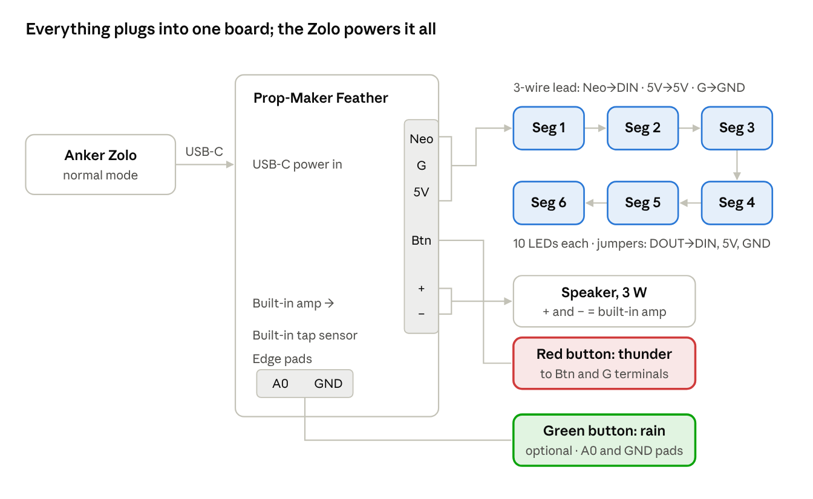
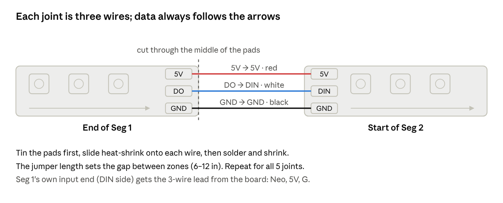

# Thunder Cloud Costume — Build Guide

## Parts and tools

The build is one Prop-Maker Feather running six LED segments, a speaker, and a button or tap trigger, powered by a USB-C power bank (an Anker Zolo in this build).

| Item | Notes |
| --- | --- |
| [Adafruit RP2040 Prop-Maker Feather (#5768)](https://www.adafruit.com/product/5768) | Brain, 3 W amp, LED output, button input, tap sensor |
| BTF-Lighting WS2812B strip, 1 m / 60 LEDs, 5V | Cut into 6 segments of 10 LEDs |
| Speaker, 3 W, 4–8 Ω | Pick an enclosed speaker (in its own small box); a bare driver in fiberfill sounds thin |
| Red momentary button, normally open | Thunder. Skip if you use tap-to-trigger only |
| Green momentary button, normally open (optional) | Rain on/off |
| USB-C power bank + USB-C data cable | Use normal mode, not trickle-charge mode |
| 22 AWG stranded wire, 3 colors | Red = 5V, black = GND, white = data |
| Heat-shrink tubing | Covers every solder joint and the strip's cut ends; add a dab of hot glue for strain relief |
| 3-pin JST-SM pigtails (optional) | Lets the cloud unplug from the board |
| Small project box or zip bag | Holds the board; keeps fiberfill out |
| Fiberfill | 1–2 bags |

**Tools:** soldering iron and solder, wire strippers, flush cutters, a small flat screwdriver (for the screw terminals), a lighter or heat gun for heat-shrink, and a computer to load the code.

A price breakdown with purchase links is in [`parts-and-costs.xlsx`](parts-and-costs.xlsx).

## Wiring diagram

Each button has two wires: one to its input (Btn or A0), one to ground (G or a GND pad). Button colors don't matter electrically.

| Board connection | Goes to | Wire color |
| --- | --- | --- |
| **Neo** terminal | Seg 1 DIN (data in) | white |
| **G** terminal | Seg 1 GND **and** one leg of the red button (two wires in one terminal) | black |
| **5V** terminal | Seg 1 5V | red |
| **Btn** terminal | Other leg of the red button | any |
| **+** and **−** terminals | Speaker, either way round (never to ground). These two terminals are the output of the board's built-in 3 W amp, so no separate amp is needed | any |
| **A0** edge pad (optional) | One leg of the green button | any |
| **GND** edge pad (optional) | Other leg of the green button | black |
| **USB-C** port | Power bank | cable |

Data runs Seg 1 → Seg 6 in the strip's arrow direction. The red button shares the single **G** terminal with the LED ground; skip it entirely if you use the double-pat trigger.

## Soldering and wiring

Cut the strip into six 10-LED segments, chain them with short 3-wire jumpers, then screw everything into the board's terminal block (labeled **Neo, G, 5V, Btn, +, −**).

1. **Find the input end.** Arrows printed on the strip point away from the input. The input end has pads labeled **DIN** (or DI), **5V**, **GND**.
2. **Cut into segments.** Cut straight across the middle of the copper pads between LED 10 and 11, 20 and 21, and so on. You get six segments; keep them in order and mark the input end of each.
3. **Tin the pads.** Add a small blob of solder to the three pads at both ends of each segment (only the input end on segment 1 and the output end on segment 6 are optional).
4. **Make the jumpers.** Cut five sets of three wires (red, black, white) as long as the gap you want between zones, typically 6–12 in. Strip and tin about 3 mm on each end.
5. **Chain the segments.** Solder each segment's **DOUT → next DIN**, **5V → 5V**, **GND → GND**. Data must always flow in the arrow direction. Slide heat-shrink over each joint before soldering, then shrink it.
6. **Lead to the board.** Solder a 3-wire lead (under 1–2 m) to segment 1's input: **DIN → Neo**, **5V → 5V**, **GND → G**. Add a JST-SM pigtail in this lead if you want the cloud to unplug.
7. **Speaker.** Solder wire to the speaker tabs if it has none, then screw into **+** and **−**. Polarity doesn't matter, but never connect either speaker wire to G or any ground: the amp drives both wires.
8. **Red button.** Solder two wires to the button, long enough to reach a pocket. Screw one into **Btn** and the other into **G** (it shares the LED ground terminal; twist the two ground wires together or tin them as one before tightening).
9. **Power.** Plug the power bank's USB-C cable into the board's USB-C port. That's the only power connection.
10. **Tighten and tug.** Tin stranded wire ends before they go in the screw terminals, tighten firmly, and give each wire a gentle pull. Then zip-tie all the leads to the board box so a tug pulls on the box, not the terminals or the USB-C plug.

DO on one segment always connects to DIN on the next. If a segment stays dark during the bench test, check that joint's direction first.

**Optional: green rain button.** A second momentary button turns rain on and off. The screw terminal has only one button input, so solder this button's two wires to the **A0** pad and any **GND** pad on the board's edge (the row of labeled holes). Then set `USE_RAIN_BUTTON = True` in `code.py`.

No resistors or capacitors are required: the board level-shifts the LED data to 5V, and 60 LEDs at capped brightness don't need extra power injection. Cheap insurance if your lead to Seg 1 is longer than about 3 ft: a 470–1000 µF capacitor across 5V and GND, and a 330 Ω resistor in the data wire, both at the strip end. The board has no fuse, so insulating every cut end and joint is what prevents a short.

## Software setup

Install CircuitPython once, copy three library items and the code, then drop thunder WAV files in a `thunder` folder. No compiling: the board shows up as a USB drive.

1. **Install CircuitPython (latest stable, 10.x as of Oct 2026).** Download the .UF2 for "Adafruit Feather RP2040 Prop-Maker" from [circuitpython.org](https://circuitpython.org/board/adafruit_feather_rp2040_prop_maker/). Hold the **BOOT** button, tap **RESET**, release BOOT; a drive named `RPI-RP2` appears. Drag the .UF2 onto it. The board reboots as a drive named `CIRCUITPY`.
2. **Add libraries.** Download the bundle matching your CircuitPython version from the [Library Bundle](https://circuitpython.org/libraries) page, unzip it, and copy into `CIRCUITPY/lib`:
   - `neopixel.mpy`
   - `adafruit_lis3dh.mpy`
   - the `adafruit_bus_device` folder
3. **Copy the code.** Put [`firmware/code.py`](../firmware/code.py) and [`firmware/safemode.py`](../firmware/safemode.py) at the root of `CIRCUITPY`, replacing the `code.py` already there. `code.py` runs automatically on every power-up; `safemode.py` restarts the board if a power dip ever knocks it into safe mode, so the cloud doesn't go dark for the night.
4. **Add thunder sounds.** Make a folder `CIRCUITPY/thunder` and add 6–10 clips, 8–15 seconds each. Each must be **WAV, 16-bit, mono, 22,050 Hz**. In Audacity: Tracks → Mix → Mix Stereo Down to Mono, set Project Rate to 22050, then File → Export → WAV, Signed 16-bit PCM. Every file must match that format exactly or it's skipped. Keep the total under about 6 MB (roughly 2 minutes of audio). Small speakers can't reproduce deep rumble, so before exporting: high-pass at about 120 Hz, boost 200–500 Hz a little, compress, and normalize to −1 dB. A red blink 3 times at power-up means no sound files were found.
5. **Choose the trigger.** Edit the settings at the top of `code.py` in any text editor (Mu or VS Code is easiest):

| Setting | Button only | Pat only | Both |
| --- | --- | --- | --- |
| `USE_BUTTON` | True | False | True |
| `USE_TAP` | False | True | True |

Other settings worth knowing: `TAP_MODE = 2` means a **double pat** triggers a strike, which avoids false strikes from walking or dancing; `TAP_THRESHOLD` (10–30, lower is more sensitive); `AMBIENT` is off by default, so thunder only happens on a button press or pat; set it to `"raining"` for random strikes every 25–90 seconds while rain is on, or `"always"`; `BRIGHTNESS` caps all LEDs (keep at 0.4 or below on a power bank); `VOLUME` (0.0–1.0) sets thunder loudness; `KEEPALIVE_S` sets a faint distant flicker for atmosphere. What actually keeps the power bank awake is the steady idle glow, `IDLE_COLOR`, so raise that if the bank shuts off.

**Zones.** Each of the six segments is its own zone, and every strike picks its zones at random, in one of four styles: a **single** zone flashing hard, a bolt that **jumps** between 2–4 random zones, a **burst** of 2–3 zones at once, or a **sheet** that lights the whole cloud with one random zone brightest. Faint rumble flickers during the thunder and the keep-alive flicker also land in random zones. Because zones are chosen at random, not by position in the chain, you can place the segments anywhere around the cloud. To use more or fewer zones, change `NUM_ZONES` and `LEDS_PER_ZONE` to match how you cut the strip.

**Lights follow the thunder.** At power-up the board measures the loudness of every clip, about every 50 ms. The cloud glows dim blue for a few seconds while it does this. During thunder, the whole cloud brightens and dims with the sound, strongest in the zones the bolt hit, and each sharp crack in the clip fires an extra white flash in random zones. Settings: `SOUND_REACTIVE` turns it on or off; `RUMBLE_COLOR` is the color at the loudest moment; `PEAK_LEVEL` and `PEAK_JUMP` control how loud and sudden a sound must be to count as a crack (lower them for more flashes); `SYNC_OFFSET_S` shifts the lights later if they run ahead of the sound. Clips with clear loud cracks over a quieter rumble give the best effect.

**Optional rain.** With the green button wired and `USE_RAIN_BUTTON = True`, add a folder `CIRCUITPY/rain` with 1–3 rain loops in the same WAV format. Press once to start rain, press again to stop. While it rains, the cloud shimmers with faint flickers, and each thunder strike plays over the rain, which dips in volume (`RAIN_DUCK`) so the thunder cuts through. `RAIN_VOLUME` sets rain loudness. A 30-second loop uses about 1.3 MB of the roughly 6 MB available, so a 15–20 second loop that repeats cleanly leaves more room for thunder. Three amber blinks at power-up mean the rain button is on but no rain files were found. Files in the wrong format are skipped; the reason prints in Mu's serial console.

Saving `code.py` restarts it immediately, so you can tweak and see the result in seconds.

## Test, assemble, troubleshoot

Test everything on the bench before any fiberfill goes on; fixes are much harder once it's stuffed. You can also try the light show and your sound files before the parts arrive: see [Previewing without hardware](#previewing-without-hardware).

**Bench test**

- [ ] Plug into a computer with `BRIGHTNESS` set to 0.15 (a laptop port can't supply full flashes plus thunder): all 60 LEDs glow dim blue within a few seconds
- [ ] Press the red button (or double-pat the board): a flash travels across segments, then thunder plays
- [ ] Every segment lights at some point (a dark segment = a bad joint at its input)
- [ ] Set `BRIGHTNESS` back to 0.35, switch to the power bank in normal mode, and leave it idle 30–60 minutes; it must still be running
- [ ] After assembly, double-pat the cloud where the wearer will pat it, then walk and dance around: tune `TAP_THRESHOLD` until pats work and movement doesn't trigger strikes
- [ ] Let a few strikes play with the speaker mounted: if strikes repeat on their own, the speaker is shaking the board; move it or pad the board box

**Assembly**

1. Put the board in a small box or zip bag with holes for the wires, and mount it where the wearer can reach the USB-C port, e.g. the back of a shoulder strap or a pocket.
2. Space the six segments around the cloud: front, back, left, right, top, and one where the flashes look best. Tape or stitch them to the cloud's base layer, LEDs facing outward.
3. Mount the speaker facing outward, under a thinner layer of fiberfill so the sound isn't muffled.
4. Run the button leads to a pocket or glove. If using pat-to-trigger, mount the board on a stiff plate (cardboard or plastic) against the cloud's shell near where the wearer will pat, not loose in the stuffing, so pats reach it. Keep the speaker off that plate so its rumble doesn't shake the board.
5. Add fiberfill in thin layers and check the glow as you go; thick spots hide LEDs, thin spots show hot dots.
6. Pack the power bank in a pocket or pouch with the cable strain-relieved, so a tug can't yank the port.

**Troubleshooting**

| Symptom | Likely cause | Fix |
| --- | --- | --- |
| No LEDs at all | Lead on the strip's output end, or data in the wrong terminal | Check arrows; DIN goes to **Neo** |
| LEDs stop partway | Bad joint on that segment's input | Reflow the DIN joint where it stops |
| Random colors or flicker | Loose ground or data | Tighten **G** and **Neo**; check GND joints |
| No thunder | WAV format wrong or no `thunder` folder | Re-export 16-bit mono 22,050 Hz; check the folder name |
| Board resets or goes dark on big flashes | Too much LED current | Lower `BRIGHTNESS` to 0.25; `safemode.py` restarts it automatically |
| Strikes while walking | Tap too sensitive | Raise `TAP_THRESHOLD` or keep `TAP_MODE = 2` |
| Power bank turns off when idle | Load too low between strikes | Raise `IDLE_COLOR`, e.g. to (12, 14, 36); if it still sleeps, get a Voltaic V25 (always-on USB-A ports) |

To read error messages, connect to a computer and open the serial console in Mu (Serial button); errors print there.

## Previewing without hardware

- **Browser preview** — open [`preview/storm-preview.html`](../preview/storm-preview.html) in a browser. Red and green buttons (or keys T and R) run a JavaScript copy of the strike, rain and sound-following logic with real audio. Drop in your WAV files to hear them, see whether they're board-ready, check storage use, and tune settings; **Copy for code.py** gives you the matching lines.
- **Wokwi simulation** — the [`wokwi/`](../wokwi) folder runs the real light and button logic on a simulated Raspberry Pi Pico (same RP2040 chip) with a 6 × 10 LED grid. Audio is faked. Open the [CircuitPython Pi Pico template](https://wokwi.com/projects/new/circuitpython-pi-pico), replace its `code.py` and `diagram.json` with the ones here (keep the template's Pico `"env"` value if it differs), add `requirements.txt`, and press play. After changing `firmware/code.py`, run `python wokwi/make_wokwi.py` to regenerate the simulator copy.

## Sources

- [Adafruit RP2040 Prop-Maker Feather product page](https://www.adafruit.com/product/5768)
- [Prop-Maker Feather pinouts](https://learn.adafruit.com/adafruit-rp2040-prop-maker-feather/pinouts)
- [Adafruit Prop-Maker example code](https://github.com/adafruit/Adafruit_Learning_System_Guides/tree/main/RP2040_Prop-Maker_Feather_Examples)
- [CircuitPython download for this board](https://circuitpython.org/board/adafruit_feather_rp2040_prop_maker/)
- [Wokwi CircuitPython guide](https://docs.wokwi.com/guides/circuitpython)
